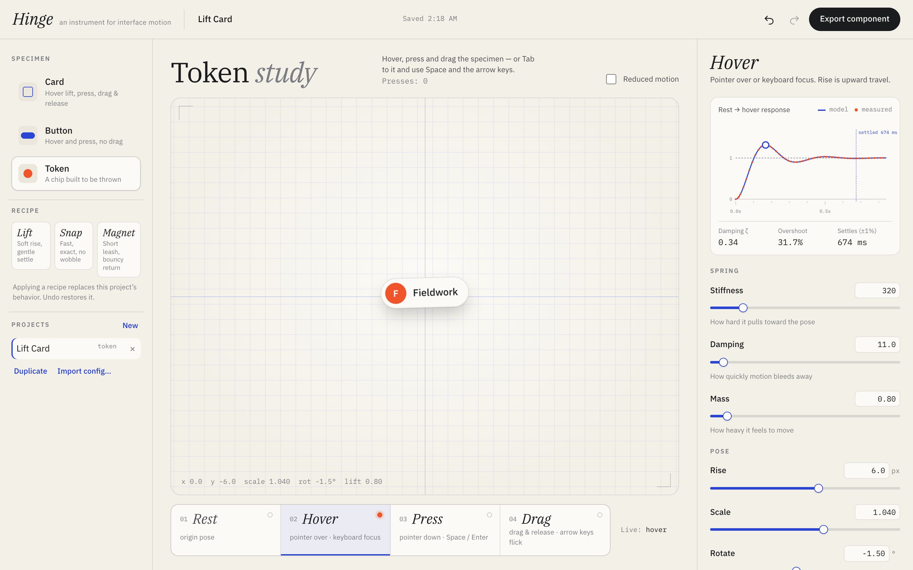

# Hinge

**An instrument for designing interface motion.** Tune how a component behaves — hover, press, drag and release — by handling it and shaping its spring, then export a working React + TypeScript component that moves exactly the way it did on the stage.

> What you feel in Hinge is what you ship.



**Live:** https://mariaareadne1.github.io/hinge/ · **Source:** this repository · MIT

## What it does

1. **Play with a specimen.** A card, a button or a draggable token sits on the stage. Hover it, press it, drag it and throw it — with a mouse, a finger, or the keyboard (Tab to focus, Space/Enter to press, arrow keys to flick).
2. **Pick a state in the Behavior Strip** — Hover, Press, Drag — and the inspector shows that state's pose and spring. The strip's lamp shows the live state as you play.
3. **Shape the spring.** Edit stiffness, damping and mass with sliders or typed values, or grab the peak of the response curve and drag it: left/right moves when it peaks, up/down sets how far it overshoots.
4. **See it measured.** The graph draws the model, then overlays dots read from the specimen's actual on-screen transform each frame. They land on the curve.
5. **Save, undo, branch.** Projects autosave locally; undo/redo treats a whole slider drag as one step; duplicate, rename, import and export configs.
6. **Export.** Copy any file or download a zip: `HingeCard.tsx`, its CSS, the runtime (`hinge/spring.ts`, `hinge/runtime.ts`, `hinge/useHinge.ts`), `hinge.config.json` and a README. The only dependency is React.

Three starting recipes feel physically different, not just numerically:

| Recipe | Character | Hover spring (k / c / m) | ζ |
| --- | --- | --- | --- |
| **Lift** | soft rise, gentle settle | 170 / 18 / 1.2 | 0.63 |
| **Snap** | fast, critically damped, no wobble | 900 / 60 / 1 | 1.00 |
| **Magnet** | short leash, bouncy return | 320 / 11 / 0.8 | 0.34 |

## How it works

```
             ┌────────────── src/runtime (shipped verbatim in every export) ──────────────┐
 pointer ─┐  │ runtime.ts   state machine: rest · hover · press · drag                    │
 touch  ──┼─▶│              capture, cancel, blur, release-outside, multi-pointer cancel  │──▶ element.style.transform
 keyboard ┘  │              per-channel springs (x, y, scale, rotate, lift)               │    --hinge-lift (shadow)
             │ spring.ts    closed-form damped oscillator  x(t), v(t)                     │
             └────────────────────────────────────────────────────────────────────────────┘
                     ▲                          │ same function                      ▲
      editor state (versioned schema,           ▼                                    │
      coalesced undo, autosave) ───────▶ SpringGraph (model curve + measured trace)   │
                     │                                                               │
                     └──────▶ export/generateReact ── specimen source + tuned BEHAVIOR ┘
```

- **One spring, solved exactly.** `spring.ts` solves `m·x″ + c·x′ + k·x = 0` in closed form for the under-, critically- and over-damped cases. There is no frame-by-frame integration, so frame rate can't change the motion, and the curve Hinge draws is literally the function the element follows. Unit tests check the closed form against an independent numerical integration, all corners of the parameter space for finite, converging output, and the graph handle's inverse mapping (peak time + overshoot → k, c) round-trip.
- **One runtime, everywhere.** The stage renders the specimen components in `src/specimens/`; an export is that same source with the behavior import replaced by the tuned values and the runtime files copied byte-for-byte. Nothing in an export imports Hinge.
- **Motion that stays continuous.** Changing state re-seeds each channel's spring from its current position *and velocity*; channels whose target doesn't change keep the spring already in flight (so a release gliding home isn't hijacked by a hover change). The frame loop runs only while something is moving.

## Verification

| Check | Command | Result (2026-10-21, macOS 26.4, M2 Pro) |
| --- | --- | --- |
| Types, strict | `pnpm typecheck` | pass |
| Lint | `pnpm lint` | pass |
| Unit — spring math, schema, history, storage, codegen, zip | `pnpm test` | 32 / 32 |
| Editor E2E — Chromium **and** WebKit | `pnpm test:e2e --grep-invert parity` | 16 / 16 per engine |
| Export parity — Chromium | `pnpm test:e2e export-parity` | 8 / 8 |

**Export parity, concretely.** The test generates two components from two different projects (a Lift card with a custom hover spring and pose; a Magnet token with custom drag and press springs), writes them into a fresh Vite + React app in a temporary directory *outside* this repository, installs only the declared dependencies, type-checks and builds it, and serves it. It then drives the editor stage and the exported component with identical input and records the element's computed transform every frame:

| Motion | Largest raw difference, editor vs export |
| --- | --- |
| A — hover rise (y) | 0.23 px |
| A — hover scale / rotate | 0.001 / 0.03° |
| A — press scale | 0.001 |
| A — drag release (x, from 100 px) | 0.07 px |
| B — keyboard flick (x, 900 px/s impulse) | 0.43 px |

Both are also checked against the analytic model, and the exported components are checked for touch tap, Enter/Space activation, a `type="submit"` button submitting its form by mouse, Enter and Space (drags never activate), `element.click()` activation as assistive tech uses it, ARIA roles, reduced motion (every frame is either the rest or the target pose, never in between) and for leaks: ten mount/unmount cycles mid-animation leave no `requestAnimationFrame` running and no window listeners behind.

*How the tolerances are defined:* a recorder samples on its own animation frame, so each value can be read up to a frame after it was written. Comparisons fit one latency offset (≤ 34 ms) and allow deviation of |slope| × 1/60 s per sample; the raw numbers above are with **no** such allowance. Tests that measure absolute time on a heavily loaded machine are the most sensitive — they passed on repeat, but this is a machine that is often busy.

**Not verified:** physical touch devices (touch is emulated), Firefox, Safari on iOS, screen readers beyond role/label checks, React 18 at runtime (declared `>=18.2`; only React 19.3 is built in the fixture).

## Accessibility

Specimens are focusable with `role="button"` (the Button is a real `<button>`); Enter/Space press and activate; keyboard focus — not click focus — stands in for hover; arrow keys give the draggable specimens a flick through the same release spring; every slider has a typed numeric equivalent with validation; the graph handle is a keyboard-operable `slider`; reduced motion is honoured from the OS and can be previewed with a toggle.

## Run it

```bash
pnpm install
pnpm dev            # http://localhost:5401
pnpm test           # unit
pnpm test:e2e       # Playwright: editor in Chromium + WebKit, export parity in Chromium
node scripts/screenshots.mjs   # regenerate docs/media (dev server running)
```

## Project layout

```
src/runtime/     spring.ts · runtime.ts · useHinge.ts — exported verbatim
src/specimens/   HingeCard / HingeButton / HingeToken + CSS — rendered on stage and exported
src/domain/      schema.ts (versioned model, recipes, validation) · history.ts (coalesced undo)
src/storage/     localStorage library with corrupt-data recovery
src/export/      generateReact.ts · createBundle.ts (zip) · sources.ts (?raw imports)
src/components/  Stage, BehaviorStrip, Inspector, SpringGraph, ScrubField, ExportDialog, Shelf, TopBar
tests/unit/      vitest
tests/e2e/       editor.spec.ts · export-parity.spec.ts · measure.ts
export-fixture-template/   the clean app exports are built in
```

See [DECISIONS.md](DECISIONS.md) for the architecture trade-offs and [PROGRESS.md](PROGRESS.md) for status.

## Credits

Built by [Maria Showalter](https://mariashowalter.com). Fonts: IBM Plex (SIL Open Font License) via Fontsource. Zip: fflate (MIT). See [THIRD_PARTY_NOTICES.md](THIRD_PARTY_NOTICES.md).
